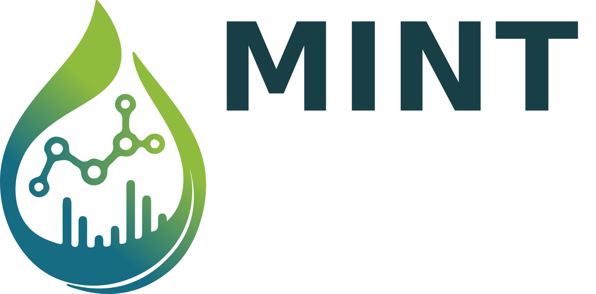
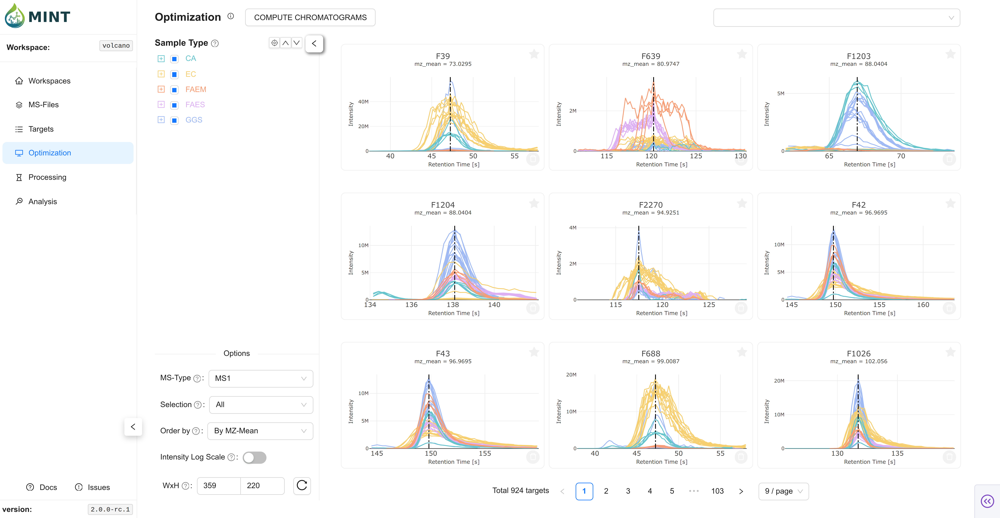

[](https://pypi.org/project/ms-mint-app2/)
[](https://pypi.org/project/ms-mint-app2/)
[](https://lewisresearchgroup.github.io/ms-mint-app2/quickstart/)
[](https://deepwiki.com/LewisResearchGroup/ms-mint-app2)
[](https://github.com/LewisResearchGroup/ms-mint-app2/issues)


<p align="center">
  
</p>

## MINT (Metabolomics Integrator)

A powerful post-processing tool for **LC-MS based metabolomics** that simplifies peak integration, quality control, and data analysis.

- **[Full Documentation](https://LewisResearchGroup.github.io/ms-mint-app2/)** - Complete user guide
- **[Quick Start Tutorial](https://LewisResearchGroup.github.io/ms-mint-app2/quickstart/)** - Get up and running in 5 minutes


## Cite us

<a href="https://www.scimagojr.com/journalsearch.php?q=23915&amp;tip=sid&amp;clean=0" title="SCImago Journal &amp; Country Rank"></a>

If you use MINT in your research, please cite the original paper:

Mario E. Valdés-Tresanco, Mario S. Valdés-Tresanco, Soren Wacker, Nicholas I. Brodie, Luis F. Ponce, Raied Aburashed, Alikhan Mansuri, Ryan A. Groves, Annegret Ulke-Lemée, Ian A. Lewis; MS-MINT: An Open-Source Data Analysis Software for Large-Scale Metabolomics Studies. Anal. Chem. 9 June 2026; 98 (22): 15988-15994.
[https://doi.org/10.1021/acs.analchem.6c01083](https://doi.org/10.1021/acs.analchem.6c01083)

<br clear="right">

## Key Features

- **Targeted Peak Integration** - Extract chromatograms and quantify peaks from mzML/mzXML files
- **Interactive Visualization** - Explore chromatograms, heatmaps, and clustering results
- **ROI Optimization** - Refine Regions of Interest (ROIs) with interactive feedback
- **Optional Quantification (SCALiR)** - Available in the Processing tab for absolute quantification when needed
- **DuckDB Backend** - Fast, efficient storage for large datasets
- **Desktop App** - Available as standalone Windows and Linux executable

<p align="center">
  
</p>

## Quick Start

### Installation with pip (Recommended)

```bash
# Create conda environment. Requires Python 3.12+
conda create -n ms-mint-app2 python==3.12
conda activate ms-mint-app2

# Install the package from PyPI
pip install ms-mint-app2

# Run MINT
Mint
```

Builds are provided with all dependencies integrated for [Windows](https://github.com/LewisResearchGroup/ms-mint-app2/releases/download/v2.0.0-rc.2/Mint-Windows-x64.zip) and [Linux](https://github.com/LewisResearchGroup/ms-mint-app2/releases/download/v2.0.0-rc.2/Mint-Linux-x64.tar.gz).

For detailed installation instructions, see the [Installation Guide](https://lewisresearchgroup.github.io/ms-mint-app2/install/).

## Publications Using MINT

1. Brown K, et al. [Microbiota alters the metabolome in an age- and sex-dependent manner in mice.](https://pubmed.ncbi.nlm.nih.gov/36906623/) *Nat Commun.* 2023;14: 1348.

2. Ponce LF, et al. [SCALiR: A Web Application for Automating Absolute Quantification of Mass Spectrometry-Based Metabolomics Data.](https://pubs.acs.org/doi/10.1021/acs.analchem.3c04988) *Anal Chem.* 2024;96: 6566–6574.

## Contributing

All contributions are welcome! This includes:
- Bug reports and fixes
- Documentation improvements
- Feature requests and enhancements
- Code reviews

Please open a [GitHub issue](https://github.com/LewisResearchGroup/ms-mint-app2/issues) to get started.

## Acknowledgements

This project builds on the amazing open-source community:

Special thanks to [GitHub](https://github.com),[PyPI](https://pypi.org/), and the [Plotly Community](https://community.plotly.com/) for their invaluable resources.

## License

This project is licensed under the Apache License 2.0.

---
